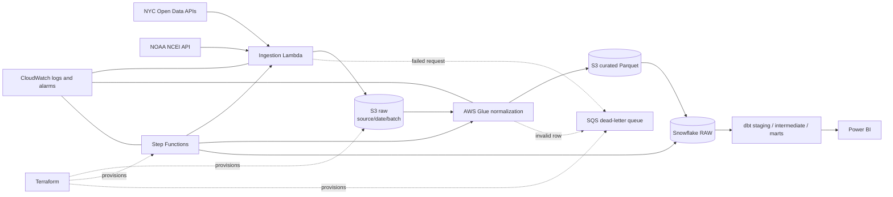

# Architecture

Raw objects are immutable, gzip-compressed JSON Lines and partitioned by `source`,
`ingest_date`, and `batch_id`. Glue standardizes types and writes curated Parquet.
The state machine applies bounded retries and routes terminal failures to SQS.
Snowflake preserves ingestion metadata and dbt builds the dimensional layer.

The local DuckDB evidence path implements the same logical dimensions, facts,
quality checks, and reporting marts without representing itself as a deployed AWS
or Snowflake environment.

